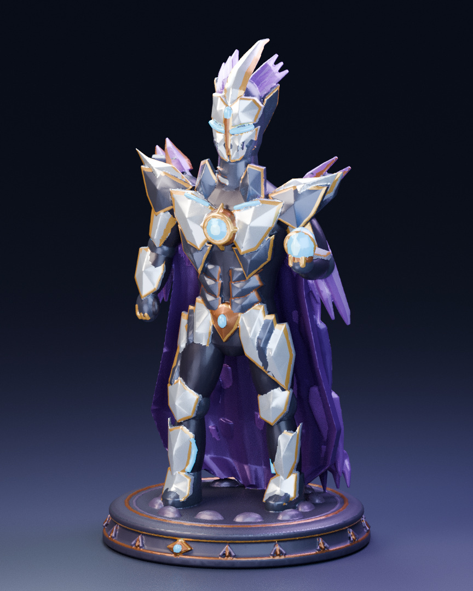

# Astral Sentinel

An original Aetherfall display figure inspired by the supplied armored-knight and feather-mantle references. The closed helm, violet mantle, raised crystal, and eclipse plinth belong to this collectible proposal.



[Four-angle turnaround](turnaround.jpg) · [3MF](astral-sentinel.3mf) · [STL](astral-sentinel.stl) · [Editable Blender scene](astral-sentinel.blend)

## Print

The figure and plinth form one solid shell measuring **63.0 × 63.5 × 119.2 mm**. Open the 3MF for embedded millimeter units. For the STL, import at 100% in millimeters. Both exports contain the same geometry. The render colors are a painting guide.

For FDM, start with the plinth down. The CuraEngine check used a 0.4 mm nozzle, 0.16 mm layers, a brim, and supports everywhere. Review supports beneath the raised arm, pauldrons, and mantle tips in your slicer. For resin, create supports and orientation for your printer and resin. Physical printing remains untested.

## Source and validation

The Blender scene includes the fused print mesh, a hidden collection with editable sculpt parts, and four studio cameras. To make changes to the editable shapes, show **Editable sculpture** and hide **Print-ready mesh**. The build script can regenerate the fused mesh and render it in Blender 4.3.

```sh
blender -b --python-exit-code 1 --python build.py -- --output /tmp/astral-sentinel
```

The Blender render uses the fused geometry. Blender reimported the STL and matched the mesh volume, dimensions, and topology metrics. A strict lib3mf import confirmed one oriented, manifold build item in millimeters. [Mesh report and export hashes](mesh-report.json)
