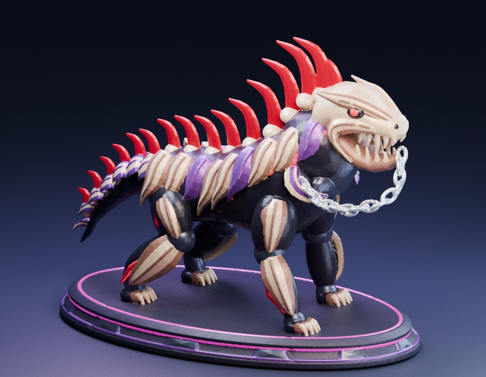

# Razor

A printable Blender sculpt proposal based on the owner-supplied Razor reference. The bone-rail hound has a raised skull with an open jaw, curved dorsal blades, interlocking bone armor, a fixed chain, and an inset-rail display pedestal.



[Neutral clay render](razor-clay.jpg) · [Four orthographic views](views) · [3MF](razor.3mf) · [STL](razor.stl) · [Editable Blender source](razor.blend)

## Print

The figure and pedestal form **one watertight shell**, measuring **72.0 × 127.1 × 95.8 mm**. The 3MF stores millimeter units. Import the STL at 100% in millimeters. The jaw teeth, chain links, and tail are fixed parts of the sculpt. The color render is a painting guide.

CuraEngine generated supported toolpaths with the base down, a 0.4 mm nozzle, a 0.16 mm layer height, and a skirt. Inspect supports near the chain, teeth, tail, and underside before printing. Physical printing remains untested.

## Source

The Blender scene includes the fused print mesh and an editable sculpture collection. The reference informed this collectible proposal. Gameplay, the canonical character registry, and art approvals require their existing review process.

```sh
blender -b --python-exit-code 1 --python build.py -- --output /tmp/aetherfall-razor
```

[Mesh, slicer, and artifact checksums](mesh-report.json)
